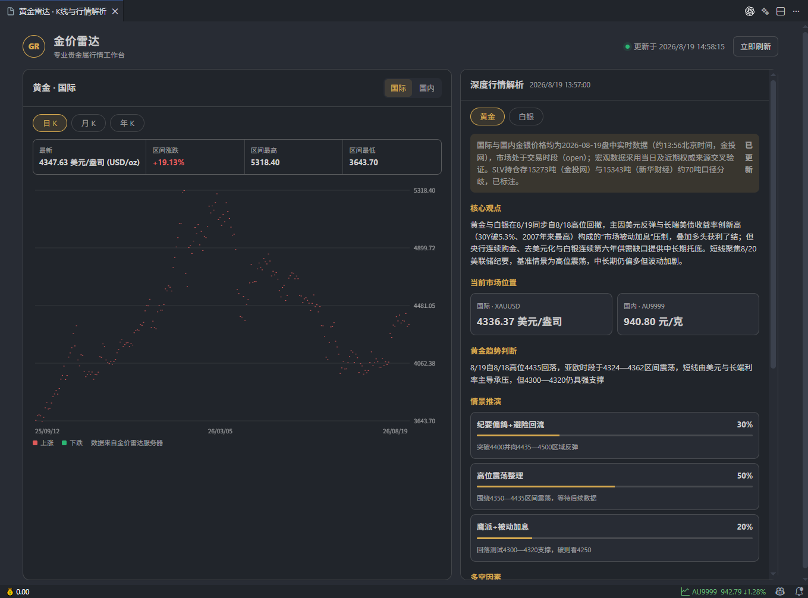

# 金价雷达  

获取当前国际金价和国内金价，展示在状态栏，方便在编辑器中随时查看当前黄金价格情况，点击状态栏还能查看价格k线，以及市场行情的深度解析。

## 特别提醒

### **价格基于第三方接口获取，数据仅用于个人学习和研究目的。插件不做价格准确性、及时性保证，投资风险用户自负！祝大家都发财！**

## 功能特色

- 点击状态栏打开国际/国内黄金、白银的日 K、月 K、年 K。

- 展示最新深度行情解析、多空因素和情景推演。

- 根据配置的预警价格规则进行预警提醒（可关闭提醒）。

- 点击StatusBar展示黄金价格走势图表

- 右键或者ALT+5快捷键可以手动刷新黄金价格

- 收盘提醒功能，14:50,14:55两次提醒收盘。

- 价格类型配置项，支持选择显示AU9999或XAU国际金价

## 配置 

在 vscode 设置中搜索`GoldPriceRadar`,根据提示配置即可。

| ID| 说明 | 默认值 |
|-|-|-|
| goldPriceRadar.updateInterval | 数据更新间隔（分钟）| 5
| goldPriceRadar.priceReminder | 价格提醒 | true
| goldPriceRadar.earlyWarningInterval | 预警间隔（分钟） | 30 |
| goldPriceRadar.earlyWarningMAx | 高于这个价格将会提醒 | 900
| goldPriceRadar.earlyWarningMin | 低于这个价格将会提醒 | 800
| goldPriceRadar.closingReminder | 收盘提醒 | true
| goldPriceRadar.priceType | 价格类型，AU9999国内金价，XAU国际金价 | AU9999

## 常见问题 

#### 无法安装
    
请检查vscode版本，确保vscode或者vscode衍生编辑器（trae、cursor）中vscode版本^1.96.0

#### 价格获取失败

右键或者ALT+5快捷键手动刷新价格，还不行的话重启编辑器

#### 没有提醒

检查是否开启编辑器的“免打扰模式”，关闭免打扰或者将插件加入提醒白名单

<!-- [如果插件对你有帮助，你想请我喝咖啡](https://github.com/stack-stark) -->
## 如果插件对你有帮助，你想请我喝咖啡

